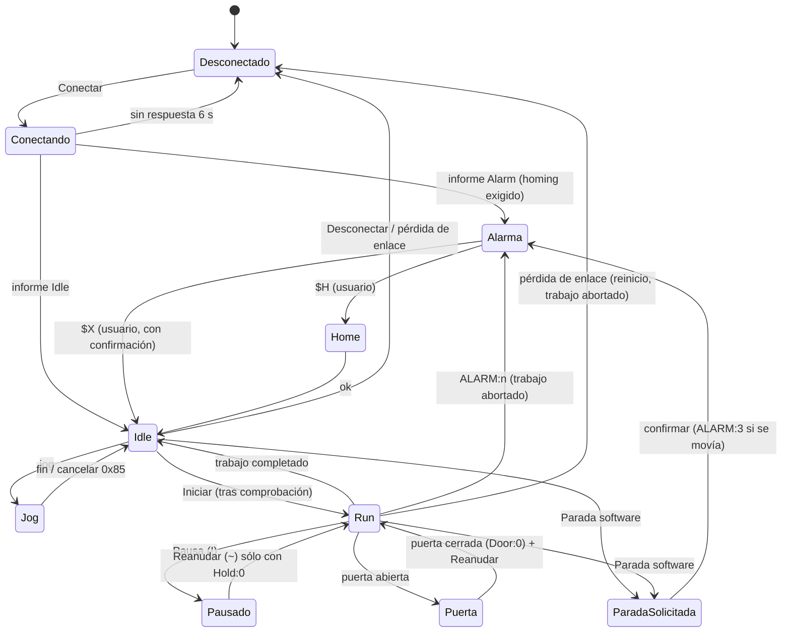

# OpenLaser Studio — Arquitectura (Fases 1-4)

Este documento responde a los seis puntos previos al código que pide el encargo: arquitectura,
máquina de estados, modelo de coordenadas, garantía de láser apagado, dependencias con licencias
y esquema de la pantalla principal.

## 1. Resumen de la arquitectura

Decisión tecnológica: se mantiene la pila recomendada (Python 3.12 + PySide6/Qt 6). Cumple todas las
condiciones (multiplataforma, interfaz fluida, serie estable con pyserial, `QGraphicsView` para miles
de vectores, empaquetado con pip/PyInstaller) y permite probar el núcleo sin interfaz.

```
src/openlaser/
  app/            identidad configurable (OPENLASER_APP_NAME) y rutas de usuario
  i18n/           tr() con cadenas fuente en español + catálogo inglés (en.py)
  ui/             ventana principal, paneles, diálogos, iconos SVG propios, temas, puente Qt
  canvas/         lienzo QGraphicsView, cuadrícula adaptativa, reglas
  document/       modelo de documento (capas, formas) y patrón Command (Deshacer/Rehacer)
  geometry/       sistemas de coordenadas documento ↔ máquina ↔ trabajo
  gcode/          generador (modo Línea) y analizador (límites, tiempo, vista previa)
  devices/        perfiles de dispositivo y transportes: simulador, serie, TCP/Telnet, WebSocket
  machine/        protocolo GRBL, cola con conteo de caracteres, estados, controlador (hilo propio)
  simulator/      simulador GRBL 1.1 en proceso y servidor TCP
  safety/         clasificación de comandos, comprobación previa, límites del disparo, registro
  persistence/    escritura atómica (tmp + fsync + os.replace + .bak) y preferencias versionadas
  diagnostics/    registro JSON por línea con QueueHandler (no bloquea la interfaz)
  plugins/        registro de adaptadores de controlador (GRBL disponible; resto previsto)
  importers/ exporters/ image_processing/ toolpath/ camera/ materials/ simulation/   (fases 2-4)
tests/            116 pruebas: 109 de núcleo + 7 de humo de la interfaz
```

Principios aplicados:

| Principio | Implementación |
|---|---|
| Documento independiente de la interfaz | `document/model.py` es Python puro; el lienzo sólo lo dibuja |
| Command para Deshacer/Rehacer | `document/commands.py` (`UndoStack`, fusión de ediciones consecutivas) |
| Comunicación en hilo propio | `MachineController` tiene un hilo; la interfaz sólo encola peticiones |
| Máquina de estados | `machine/states.py`: conexión × GRBL × trabajo → estado visible y acciones permitidas |
| Cola con confirmación | `machine/command_queue.py`: conteo de caracteres (127 B), `ok`/`error` retiran la línea más antigua, comandos `$` exclusivos |
| Separación de coordenadas | `geometry/coords.py` |
| Eventos para la interfaz | el hilo publica eventos inmutables en una `queue.Queue`; `ui/bridge.py` los reemite como señales Qt cada 30 ms |
| Persistencia atómica | `persistence/atomic.py` |
| Registro sin bloqueo | `diagnostics/logging_setup.py` |
| Controladores como adaptadores | `devices/transport.py` + `plugins/controllers.py` |

Flujo de datos:

```
 UI (hilo Qt) ──peticiones──▶ MachineController._inbox ──▶ hilo máquina ──bytes──▶ Transporte ──▶ GRBL
      ▲                                                       │                                    │
      └──señales Qt◀── MachineBridge (QTimer 30 ms) ◀── events (Queue) ◀── parser ◀── líneas ◀───────┘
```

La parada de software es la única excepción: escribe `0x18` directamente en el transporte desde el
hilo de la interfaz (el transporte tiene cerrojo de escritura) para no esperar a la cola.

## 2. Máquina de estados

Tres ejes independientes:

* **Conexión**: `DISCONNECTED → CONNECTING → CONNECTED → DISCONNECTING → DISCONNECTED`.
  `CONNECTING` pasa a `CONNECTED` con el primer informe `<…>`; si no llega en 6 s, o si estando
  conectado no hay respuesta a `?` en 5 s, se considera conexión perdida.
* **GRBL** (del informe de estado): `Idle, Run, Hold, Jog, Home, Check, Door, Alarm, Sleep`.
* **Trabajo**: `NONE → RUNNING ⇄ PAUSED → STOPPING → ABORTED | COMPLETED`.

Estado visible (`DisplayState`), con prioridad de arriba abajo:

| Condición | Estado visible |
|---|---|
| parada de software sin confirmar | **Parada solicitada** (ESTOP) |
| desconectado (con/sin error) | Error / Desconectado |
| conectando | Conectando |
| GRBL `Alarm` | Alarma |
| GRBL `Door` | Puerta abierta |
| trabajo en pausa o `Hold` durante trabajo | Pausado |
| resto | Idle, Run, Hold, Jog, Home, Check, Sleep |



Acciones permitidas (`allowed_actions`), resumen:

| Acción | Permitida en |
|---|---|
| Conectar | sólo desconectado |
| Stop, Parada software, Desconectar | siempre que haya conexión |
| Home | Idle o Alarm, sin trabajo |
| Desbloquear | Alarm, sin trabajo |
| Jog | Idle o Jog, sin trabajo, sin disparo, sin parada pendiente |
| Origen, ir a, frame, iniciar, disparo de enfoque | sólo Idle sin trabajo |
| Pausa | trabajo en marcha |
| Reanudar | Hold/Door con subestado 0, o trabajo en pausa; **nunca** tras alarma |
| Consola / `$$` | Idle o Alarm sin trabajo |

Con parada de software pendiente o con el disparo de enfoque activo sólo se permite Stop,
Parada software y Desconectar.

## 3. Modelo de coordenadas

* **Documento**: mm, origen en la esquina superior izquierda del área, Y hacia abajo (como SVG). Es
  la escena del lienzo.
* **Máquina (MPos)**: mm desde el origen físico (homing). Esquina de origen y sentido de ejes vienen
  del perfil (`origin`, `invert_x`, `invert_y`).
* **Trabajo (WPos)**: `WPos = MPos − WCO`, donde WCO es el desplazamiento G54 (+G92) que informa GRBL.
  El G-code se emite en coordenadas de trabajo.

```
doc → máquina:  mx = (W − x) si el origen está a la derecha (xor invert_x), si no x
                my = (H − y) si el origen está delante  (xor invert_y), si no y
máquina → doc:  la misma fórmula (es una involución)
máquina ↔ trabajo:  w = m − WCO ;  m = w + WCO
```

Modos de colocación del trabajo: **absoluto** (lo que se ve en el lienzo es donde se corta; se resta
WCO) y **origen de usuario** (la esquina inferior izquierda del diseño va a X0 Y0 de trabajo).
La cuadrícula y las reglas se dibujan alineadas al origen de máquina.
Los límites se comprueban en coordenadas de máquina (`0…ancho`, `0…alto`) sólo cuando hay homing;
sin homing la aplicación avisa de que no puede verificarlos.

## 4. Cómo se garantiza que el láser permanece apagado

1. **Al conectar** no se envía ningún movimiento, ni `$H` ni `$X`; sólo `$I`, `$$` y `$G`. Si el
   informe muestra husillo/láser activo en reposo, se envía `M5`.
2. **Movimientos manuales**: jog con `$J=` (nunca lleva S); ir a, ir al origen y frame van precedidos
   de `M5` y usan `G0` o `G1 … S0`. Las pruebas verifican en el simulador que no hay ninguna emisión.
3. **Modo láser**: se lee `$32`; si no es 1 se avisa en la comprobación previa (sin modo láser el
   láser podría quedar encendido en paradas). También se comparan `$30` y `$13` con el perfil.
4. **Disparo de enfoque**: requiere confirmación con dos casillas, potencia ≤ límite (1 % por defecto,
   máximo absoluto 5 %), duración ≤ límite (3 s por defecto, máximo 10 s) y máquina en reposo. Se
   envía como bloque `G1F1000M3S… → G4P… → M5G0`, de modo que **el propio controlador lo apaga**
   aunque se pierda el enlace; además un vigilante en el hilo de máquina envía reinicio si se supera
   el tiempo. Bloquea jog, frame e inicio mientras dura.
5. **Stop**: retención (`!`), espera a `Hold:0` y reinicio (`0x18`), vaciando la cola. **Parada de
   software**: `0x18` inmediato desde la interfaz. En GRBL el reinicio apaga el husillo/láser.
6. **Desconexión o excepción**: si hay actividad se envía `0x18` antes de cerrar; si el enlace se
   pierde se vacía la cola, se aborta el trabajo y se pide verificación física. En USB con placas
   Arduino, reabrir el puerto reinicia el controlador.
7. **Alarmas**: nunca se desbloquea ni se reanuda automáticamente; el diálogo de alarma ofrece el
   comando de recuperación sólo tras una segunda confirmación.
8. **Consola y macros**: los comandos que encienden el láser (`M3/M4` con S>0, S>0) o modifican
   parámetros (`$n=`, `$X`, `$RST`) se rechazan sin confirmación explícita.
9. **Trabajos**: se rechazan comandos `$` dentro del G-code; al final de cada trabajo se añade `M5`;
   los comandos de inicio/fin del perfil no pueden contener `$` ni M3/M4 con potencia.
10. **Jog continuo**: segmentos de 0,2 s con latido de la interfaz cada 100 ms; si el latido falta
    0,6 s se cancela el jog (`0x85`).

> El software no sustituye interlocks físicos, parada de emergencia cableada, supervisión,
> ventilación ni protección ocular.

## 5. Dependencias y licencias

| Dependencia | Licencia | Uso | Fase |
|---|---|---|---|
| Python 3.12 | PSF | intérprete | 1 |
| PySide6 / Qt 6 | LGPL-3.0 (también GPL/comercial) | interfaz; enlace dinámico | 1 |
| pyserial | BSD-3-Clause | USB/serie | 1 |
| websockets | BSD-3-Clause | WebSocket | 1 |
| pytest | MIT | pruebas (desarrollo) | 1 |
| PyInstaller (opcional) | GPL-2.0 con excepción de bootloader | ejecutable autónomo | 1 |
| Shapely | BSD-3-Clause | booleanas, offsets | 2 |
| ezdxf | MIT | DXF | 2 |
| svgpathtools | MIT | SVG | 2 |
| NumPy | BSD-3-Clause | ráster, geometría | 3 |
| Pillow | MIT-CMU (HPND) | imágenes | 3 |
| OpenCV (opencv-python) | Apache-2.0 | cámara, calibración | 4 |

Detalle y obligaciones en `docs/LICENCIAS.md`. No se usa código, iconos, textos ni recursos de
LaserGRBL ni LightBurn; los protocolos propietarios (Ruida, Trocen, galvo) no se implementan por
ingeniería inversa.

## 6. Esquema de la pantalla principal

```
┌─ Archivo Editar Dibujar Organizar Capas Láser Máquina Cámara Herramientas Ventana Ayuda ───────────────────┐
├─ [nuevo][abrir][guardar][imp][exp] | [desh][reh][cortar][copiar][pegar][borrar] | [vista][frame][▶][‖][▶|]│
│  [■] | [⌂][conectar][cámara][rotary][prueba mat.][dispositivo]                                             │
├─ [zoom][ajustar][centrar] | [alinear][distribuir][agrupar][desagrupar] | [unir][restar][inters][offset]… ──┤
├────┬─ FRANJA DE SEGURIDAD (fija) ─────────────────────────────────────────────────────────────────────────┤
│ H  │ [● Reposo] [○ Láser apagado] [⌂ Home hecho] [▮ Puerta cerrada]          X 120.000  Y 160.000  Z … A … │
│ e  │ ℹ último aviso de seguridad…                         [Pausa] [Reanudar] [Detener] [■ PARADA SOFTWARE]  │
│ r  ├──────────┬──────────────────────────────────────────────────────────┬───────────────────────────────┤
│ r  │MOVIMIENTO│  regla horizontal (mm de máquina)                        │ CAPAS Y OPERACIONES │PROPIED.│CÁM│
│ a  │ X  Y Z A │ ┌──────────────────────────────────────────────────────┐ │ ■ nombre modo vel pot pas sal │
│ m  │ ↖ ↑ ↗ Z+ │r│  área de trabajo con cuadrícula                      │ │ ■ …                           │
│ .  │ ← ⌂ → A± │e│   formas del documento (color de capa)               │ ├───────────────────────────────┤
│    │ ↙ ↓ ↘ Z− │g│   ✛ cabezal   └ origen de trabajo                    │ │ LÁSER                         │
│ d  │0.1 1 10..│l│   vista previa: rojo corte / gris desplazamiento     │ │ origen · copias · análisis    │
│ i  │paso vel  │a│   frame discontinuo                                  │ │ [vista][frame][INICIAR]       │
│ b  │continuo  │ │                                                      │ │ [pausa][reanudar][detener]    │
│ u  │Home Desb.│ └──────────────────────────────────────────────────────┘ │ progreso · tiempo · línea     │
│ j  │Origen…   │                                                          │ overrides avance/rápido/pot.  │
│ o  │Ir a X/Y  ├──────────────────────────────────────────────────────────┴───────────────────────────────┤
│    │Posiciones│ CONSOLA GRBL  [TX][RX][Info][Avisos][Estado][Trabajo][Hora] filtro…        [vaciar][export]│
│    │Disparo   │ 12:00:01.123 » $J=G91G21X10F3000   « ok                                                    │
│    │enfoque   │ [macro][macro]…[Macros…]      [comando…………………………………………………………] [Enviar]                         │
├────┴──────────┴──────────────────────────────────────────────────────────────────────────────────────────┤
│ cursor X… Y… │ conexión │ X… Y… Z… A… │ F … mm/min · S … │ [progreso] │ 00:00 / 00:00 │ [● estado]        │
└───────────────────────────────────────────────────────────────────────────────────────────────────────────┘
```

Todos los paneles (Movimiento, Capas, Propiedades, Cámara, Láser, Consola) son `QDockWidget`
acoplables, flotantes, redimensionables y ocultables; *Ventana → Restablecer distribución* vuelve a
esta disposición. La franja de seguridad forma parte del área central y no se puede ocultar.

## 7. Documento vectorial (Fase 2)

```
 CanvasView ──señales──▶ DocumentActionsMixin ──edit_document()──▶ operations.py ──▶ Document
 (herramientas,            (main window)          instantánea antes/después            (Layer, Shape
  tiradores, nodos)                                 ▼                                    inmutable)
        ▲                                        UndoStack ──listeners──▶ lienzo, capas, propiedades,
        └──────────────── set_document() ◀───────────────────────────────  análisis (300 ms), título «•»
```

* **Geometría inmutable**: `Node`, `SubPath` y `Shape` son `dataclass(frozen=True)`; cada operación
  crea objetos nuevos. Deshacer guarda sólo las listas de referencias (`DocumentEdit`), así que una
  instantánea cuesta O(n) punteros y nunca copia geometría. Las capas sí son mutables y se guardan
  como diccionarios, conservando la identidad del objeto `Layer` al deshacer.
* **Coordenadas**: el documento está en mm con Y hacia abajo (como SVG); la conversión a máquina y a
  trabajo sigue en `CoordinateSystem` (sección 3). El DXF (Y hacia arriba) se voltea al importar y al
  exportar.
* **Curvas**: Bézier cúbicas; líneas = nodos sin manejadores; arcos SVG/DXF convertidos a cúbicas.
  Se aplanan con tolerancia 0,02 mm sólo al generar G-code o calcular áreas.
* **Orden de corte** (`toolpath/order.py`): profundidad de contención (los interiores primero) y,
  dentro de cada nivel, vecino más cercano eligiendo también el punto de entrada en contornos cerrados.
* **Proyecto `.olsp`**: ZIP con `mimetype`, `manifest.json` (formato, versiones, fechas),
  `document.json`, `device_profile.json`, `layout.json` y `resources/` (imágenes en la Fase 3).
  Escritura atómica con `.bak`; el `.json` de la Fase 1 se migra al abrir.

## 8. Ráster, generación y simulación (Fase 3)

```
 Imagen (Qt decodifica) ──▶ RasterSource (gris uint8) ──▶ Document.images[id]   (recurso .npz en el .olsp)
                                                         ▲
 Shape(kind="image", image=ImageRef(resource, esquinas, ImageSettings))   ← mover/escalar/girar/voltear
        │
        ▼  generador (caché por recurso + esquinas + ajustes)
 adjust() → sample_frame() (rejilla alineada con el documento, paso = 1/líneas por mm) → dither()
        │                                                    → filas de tramos (x0, x1, S) → G-code
 relleno: hatch() par-impar por forma + unión por fila ──────┘
 línea:   order_paths() + build_steps() (lead-in/out, puentes) + perforación
```

* **No destructivo**: el original nunca se modifica; `ImageSettings` (inmutable) guarda los ajustes y
  forma parte de la forma, así que deshacer/rehacer y el guardado funcionan igual que con vectores.
  Las esquinas del marco (superior izquierda, superior derecha, inferior izquierda) definen una
  transformación afín: giro y espejo se aplican al remuestrear.
* **Recorte**: cambiar el recorte recalcula las esquinas para conservar escala y posición.
* **Emisión por filas** (relleno e imagen): `G0` al inicio menos el overscan, `G1 … S0` de
  aceleración, tramos con su potencia y `G1 … S0` de salida. Ningún `G0` se emite con S≠0 modal.
* **Rendimiento**: tramado por difusión de error con bucle por fila (la parte vertical vectorizada),
  caché del resultado tramado y de las líneas G-code por imagen, índice espacial para el orden de
  corte y la profundidad de anidamiento, y análisis del trabajo en un hilo de fondo (con instantánea
  del documento) para no bloquear la interfaz.
* **Simulación**: `build_timeline()` convierte el G-code (con los comentarios `; capa:` del generador)
  en movimientos con instante inicial/final; el lienzo dibuja los tramos agrupados por color con
  `drawLines` hasta el movimiento actual. `checks.py` aporta el diagnóstico (geometría y límites).
* **Vectorización**: umbral (Otsu) → apertura/cierre morfológicos → marching squares (contornos
  orientados) → Ramer-Douglas-Peucker → esquinas → suavizado de los vértices no esquina → Bézier
  Catmull-Rom.

## 9. Cámara, rotary, pruebas y plugins (Fase 4)

* **Cámara**: píxel → (lente radial inversa) → píxel corregido → homografía `H` → máquina → documento.
  En el lienzo se usa una `QTransform` proyectiva `A·H` (A = máquina→documento), así la imagen se
  dibuja corregida en perspectiva sin remuestrear. `H` se calcula por DLT normalizado con ≥ 4
  marcadores grabados en posiciones conocidas; con más de 4 se estima la precisión por el residuo.
* **Rotary**: el diseño está en mm de superficie. Tras generar, `machine_transform` reescribe Y
  (factor = mm por vuelta × relación / (π·D), D del rodillo o del objeto) o lo envía al eje A. La
  vista previa y la simulación usan el trabajo sin transformar; el análisis de límites y el envío,
  el transformado. La corrección cilíndrica proyecta `y = yc + R·sin(s/R)` subdividiendo los G1.
* **Pruebas**: `materials/test_patterns.py` genera `TestPlan` (capas + formas con un grupo común) con
  etiquetas en una fuente de trazo propia; los límites del perfil se aplican en el generador.
* **Plugins**: `plugins/<id>/plugin.json` + módulo con `register(api)`. Sólo se cargan los activados
  por el usuario; la API (versión 1) añade acciones de menú, adaptadores y pruebas, y un contexto
  que edita el documento a través de `edit_document` (deshacible). No expone el controlador.
* **PDF**: lector propio de objetos/flujos (Flate, flujos de objetos) e intérprete de operadores de
  trazado con pila gráfica; puntos PDF → mm, Y hacia arriba.

## 10. Firmwares: GRBL, grblHAL y FluidNC (Fase 5)

* Los tres hablan el protocolo de flujo de GRBL 1.1, así que comparten `MachineController`, la cola
  de conteo de caracteres, los comandos de tiempo real y todas las garantías de láser apagado. Las
  diferencias viven en `machine/dialects.py` (un `Dialect` por firmware, sin Qt).
* **Detección**: bienvenida (`GrblHAL …` → grblHAL; `… [FluidNC v…]` → FluidNC), `$I`
  (`[FIRMWARE:grblHAL]`, `[NEWOPT:…]`, `[VER:… FluidNC …]`) y campo `FW:` del estado. Una bienvenida
  `Grbl 1.1x` se confirma al terminar `$I` (grblHAL en modo de compatibilidad la muestra igual). Si
  no coincide con el perfil se avisa y se usa el detectado.
* **Búfer**: `[OPT:…,<bloques>,<búfer>]` → en vuelo como máximo `búfer − 1`. Sólo grblHAL puede
  ampliar el valor del perfil; en GRBL y FluidNC el valor informado sólo puede reducirlo.
* **Alarmas/errores**: `grbl_codes.alarm_info(code, dialect)`: 1–9 comunes; 10–17 de grblHAL y
  10–15 de FluidNC con su propio significado y su lista de alarmas que invalidan la posición.
* **Estado**: `Tool` (grblHAL) se trata como pausa; `H:` (grblHAL) fija si el homing está hecho;
  `Pn:E` (grblHAL) avisa de la parada de emergencia física; `[MSG:ERR: …]` (FluidNC) genera un aviso.
* **Parámetros**: FluidNC guarda la configuración en YAML: `$$` se lee, pero `write_setting` se
  rechaza y el diálogo de parámetros queda en sólo lectura.
* **Simulador**: `GrblSimulator(firmware=…)` imita bienvenida, `$I`, búfer, `H:`, `Pn:E`/`ALARM:10`,
  `[MSG:INFO: …]`, `$CD` y parámetros de sólo lectura; el transporte simulado sigue el firmware del
  perfil.

## 11. Marlin y Smoothieware (Fase 6, experimental)

* `machine/factory.create_controller` elige `MachineController` (familia GRBL) o `HostController`
  (Marlin, Smoothieware) según el firmware del perfil; la ventana lo rehace al conectar si cambió.
* `HostController` hereda el hilo, la cola, el trabajo, los eventos y la seguridad, y cambia:
  una línea en vuelo (`StreamingQueue.max_in_flight = 1`); comandos de tiempo real traducidos
  (`?` sólo en Smoothieware; reinicio → Marlin `M410`+`M5`, Smoothieware Ctrl-X; parada de emergencia
  → Marlin `M112`); pausa en el anfitrión (rebobina las líneas no enviadas y envía `M5`; al reanudar
  repone el último `M3/M4`); jog/frame/ir a siempre con `G0`; origen con `G92`.
* **Estado en Marlin**: no hay informe en tiempo real. Cada orden de movimiento termina con `M400`,
  así que «cola vacía» = reposo; la posición viene de `M114` (cada 0,5 s en reposo y cada 1 s dentro
  del trabajo). Conexión: sondas `M115` fuera de la cola cada 2 s y conexión cuando dejan de llegar
  respuestas (evita confundir un «ok» tardío con el de otra orden).
* **Traducción** (`host_protocols.translate_job`): S del perfil → S del firmware (255 / 1 o el valor
  del perfil); Marlin: `M3/M4` → modo en línea `I`, `G0` → `G1 … S0 F<rápido>` reponiendo F y S, `G4 P`
  en ms; Smoothieware: `S0` explícito antes del primer `G1`.
* **Detección cruzada**: si un controlador GRBL ve «start»/«FIRMWARE_NAME:Marlin»/«Smoothie», o el
  `HostController` ve un firmware distinto, se desconecta con un mensaje que indica el firmware.
* **Simuladores**: `MarlinSimulator` (cola de 4, planificador de 16, `M3` sin `I` emite parado y en G0,
  `M410`/`M112` inmediatos con `EMERGENCY_PARSER`) y `GrblSimulator(firmware="smoothie")` (emite sólo en
  G1 con S > 0 aunque no haya M3, potencia por defecto 0,8, `!!` en alarma).

